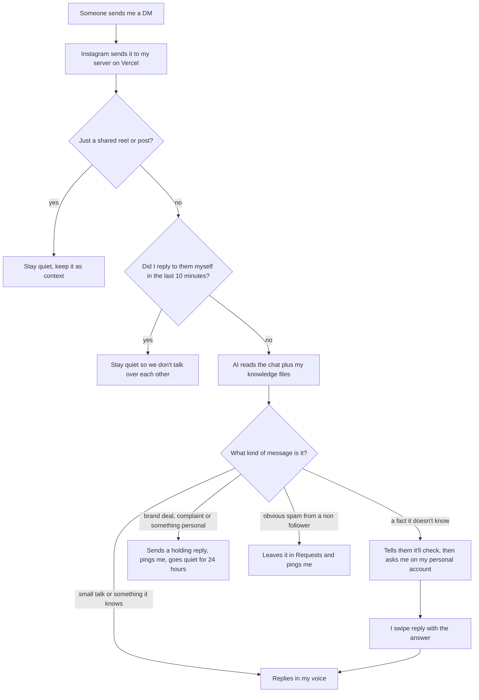

# ig-dm-autoreply

I make tech and AI videos on Instagram ([@buildwithranvir](https://instagram.com/buildwithranvir)), and at some point I couldn't keep up with my DMs anymore. Half of them were the same few questions, the other half got buried before I saw them.

So I built this. It answers my DMs in my own voice, asks me when it doesn't know something, and hands the important chats back to me. It runs for free on Vercel, so it keeps working when my laptop is off.

It only uses the official Instagram API (Instagram Login). No scraping, no unofficial libraries, nothing that gets your account flagged.

## How a message flows



## What it actually does

It replies to everyone who messages, no matter how many followers they have. Replying to a message request moves it to General, so once the bot answers someone, the chat is accepted.

The first reply in every conversation starts with a small "AI replying for Ranvir" tag, because people should know. After that it just talks like me: short, casual, and in whatever language they write in. Hinglish works fine.

It only states facts that are written in the `knowledge/` folder. If someone asks what laptop I use and that isn't written down, it doesn't guess. It says "lemme check" and asks me instead. When I answer, it sends them the reply in my voice. If I start my answer with `save`, it remembers it and never asks me that again.

Brand deals, complaints and personal stuff always come to me. It sends a short holding message and stays out of that chat for 24 hours.

Shared reels and posts get no reply. They're kept as context, so if someone sends a reel and then asks "how did you make this?", it knows which reel they mean.

## Talking to it from my personal account

Alerts and questions go to my personal Instagram account. There it talks to me like an assistant talks to its boss, which is honestly my favourite part.

| What I send | What happens |
|---|---|
| swipe reply to a ❓ alert | that answer goes to the person who asked |
| `12 macbook air` | answers question #12 |
| just the answer | answers the only open question (it asks which one if there are a few, and a plain "hey" or "ok" never counts) |
| `save` before any answer | it remembers the answer for next time |
| `inbox` | sends me any alerts that were waiting, or says all clear |
| `reset` or `forget` | fresh start, it forgets our chat and every open question |
| anything else | normal chat, good for brainstorming reel ideas |

Instagram only lets a business account message someone who messaged it in the last 24 hours. That counts for my personal account too, so if I haven't texted the bot in a day, alerts wait in a queue. The moment I send it anything, everything that was waiting comes through. It also pings me about 20 hours in, while it still can, so I can keep the window open.

## Running your own copy

You'll need a professional Instagram account (Creator or Business), a free [Groq](https://console.groq.com) key, and free accounts on [Vercel](https://vercel.com) and [Meta for Developers](https://developers.facebook.com).

**1. Instagram settings.** In the Instagram app, go to Settings, then Messages and story replies, then Message controls. Set "Others on Instagram" to Message requests. Also turn on "Allow access to messages" under Connected tools, and make sure Limits is off. Heads up: teen accounts can only receive DMs from people they follow, whatever the settings say.

**2. Meta app.** Create an app at developers.facebook.com with the "Manage messaging & content on Instagram" use case. On the "API setup with Instagram login" page, copy the Instagram app ID and app secret, add your account under "Generate access tokens", and copy the token. Then publish the app. Webhooks don't fire while it's unpublished. You don't need App Review to use it on your own account.

**3. Deploy.** Fork this repo, import it on Vercel, and add Upstash Redis from the Vercel marketplace (the free plan is plenty). Fill in the environment variables listed in `.env.example`.

**4. Connect the webhook.** Back in the Meta dashboard, set the callback URL to `https://your-app.vercel.app/webhook` and the verify token to whatever you put in `WEBHOOK_VERIFY_TOKEN`. Subscribe to the `messages` field. Use `https://your-app.vercel.app/privacy` as the privacy policy URL.

**5. Find your personal account's ID.** DM your business account from your personal one, check the Vercel logs for the sender ID, and put it in `OWNER_ALERT_IGSID`.

**6. Teach it about you.** Write your style and a few real replies in `knowledge/persona.md`, and your links and common answers in `knowledge/faq.md`. The more you put there, the less it has to ask you.

Every push to `main` redeploys on Vercel, and a daily cron job refreshes the Instagram token so it never expires.

## Running it locally

```bash
python -m venv .venv
.venv/Scripts/pip install -r requirements-dev.txt   # on Mac/Linux: .venv/bin/pip
cp .env.example .env
pytest
uvicorn app.main:app --port 8000
```

Without Upstash keys it keeps everything in memory, which is fine for testing. To get real DMs on your machine you need an HTTPS tunnel like `cloudflared tunnel --url http://localhost:8000`.

## What's where

```
app/
  main.py        webhook, token refresh cron, privacy page
  bot.py         decides what happens to each message
  ai.py          the prompts and the call to the model
  screening.py   followers vs new conversations
  instagram/     Instagram API calls, sending messages, token refresh
  owner/         alerts and questions sent to my personal account
  storage/       Redis and chat history
knowledge/       everything the bot is allowed to say about me
tests/           pytest, no network needed
```

## Good to know

- The model is `openai/gpt-oss-120b` on Groq's free tier, which handles roughly 1,000 replies a day. Any OpenAI compatible API works, just change `LLM_BASE_URL`, `LLM_API_KEY` and `LLM_MODEL`.
- If the model is down or out of free requests, nobody gets a weird reply. I get an alert instead.
- People can type "delete my data" in a DM and their chat history gets wiped.
- Vercel's free plan is meant for non commercial use, so check their terms if your page makes money.

## License

MIT, so feel free to use it, change it and build on it. See [LICENSE](LICENSE).

Made by [@buildwithranvir](https://instagram.com/buildwithranvir).
